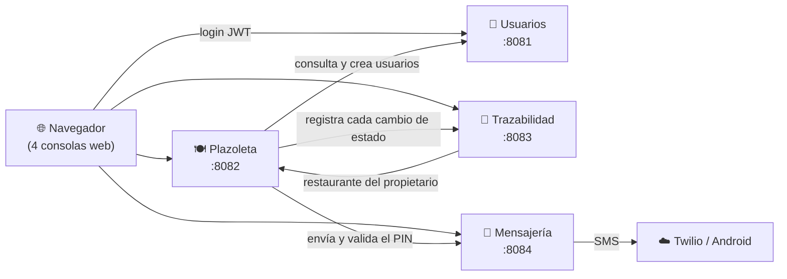

<div align="center">

```
                    ·  ·                  ·
     +                    ·
            * ·    ░░░░░░░░░░     · ·
    + ·       ·░░░░░    ·   ░░░░░
        ··  ░░░░ ▒▒▓▓▓▓▓▓▓▓▓▓▒▒·░░░░ ·
 +         ░░  ▒▓▓███      ███▓▓▒· ░░
  .       ░░ ▒▓▓██            ██▓▓▒ ░░
        ·░░ ▒▓██                ██▓▒ ░░
        ░░░▒▓▓█                  █▓▓▒░░░
░░░░▒▒▒▒▒▓▓▓▓▓▓██████████████████▓▓▓▓▓▓▒▒▒▒▒░░░░
        ░░░▒▓▓█                  █▓▓▒░░░
     ·   ░░ ▒▓██                ██▓▒ ░░·
       ·  ░░ ▒▓▓██            ██▓▓▒ ░░·
         · ░░  ▒▓▓███      ███▓▓▒  ░░   ·
        · · ░░░░ ▒▒▓▓▓▓▓▓▓▓▓▓▒▒ ░░░░·       ·
               ░░░░░        ░░░░░             *
                   ░░░░░░░░░░       ·
```

# 🍽️ Plazoleta de comidas

**Sistema de pedidos para una plazoleta de comidas, hecho con 4 microservicios Spring Boot y arquitectura hexagonal.**
Restaurantes, menú, carrito, pedidos con **PIN por SMS real**, trazabilidad y eficiencia, con una consola web para cada servicio.


[🚀 Ejecutar](#-cómo-ejecutar-el-proyecto) ·
[🖥️ Consolas](#️-consolas-web) ·
[👥 Usuarios](#-datos-iniciales) ·
[📱 SMS](#-pin-por-sms) ·
[📖 Guía de uso](GUIA.md) ·
[🧱 Arquitectura](#-arquitectura) ·
[🛠️ Problemas](#️-solución-de-problemas) ·
[💜 Redes](#-redes)

</div>

---

## 📦 Requisitos

| Necesitas | Versión | Cómo comprobarlo |
|-----------|---------|------------------|
| **JDK** (Java) | 17 o superior (probado con 21) | `java -version` |
| **Git** | cualquiera | `git --version` |
| **Internet** | solo la primera vez, para descargar dependencias, y para los SMS reales | |
| **Puertos libres** | 8081, 8082, 8083 y 8084 | |

> No hace falta instalar Maven: el proyecto trae el **Maven Wrapper** (`mvnw` en Linux/macOS, `mvnw.cmd` en Windows).
> Tampoco hace falta una base de datos: en modo local se usa **H2 en archivos** que se crean solos.

<details>
<summary><b>¿No tienes Java? Así se instala</b></summary>

- **Linux (Ubuntu/Mint/Debian):** `sudo apt install openjdk-21-jdk`
- **Windows:** descarga el instalador `.msi` de [Adoptium Temurin 21](https://adoptium.net/) y marca la opción **"Set JAVA_HOME"** durante la instalación.
- **macOS:** `brew install openjdk@21`

Después cierra y vuelve a abrir la terminal y comprueba con `java -version`.
</details>

---

## 🚀 Cómo ejecutar el proyecto

Un solo comando arranca **los 4 microservicios a la vez**. `Ctrl + C` los detiene todos.

### 🐧 Linux / macOS

```bash
# 1. Descargar el proyecto
git clone https://github.com/MichEverest/Plazoleta.git
cd Plazoleta

# 2. (Solo la primera vez, si da "Permiso denegado")
chmod +x mvnw mensajeria/configurar-sms.sh

# 3. Arrancar todo
./mvnw spring-boot:run
```

### 🪟 Windows

Abre **PowerShell** o **CMD** (o la terminal de VS Code) y ejecuta:

```powershell
# 1. Descargar el proyecto
git clone https://github.com/MichEverest/Plazoleta.git
cd Plazoleta

# 2. Arrancar todo
.\mvnw.cmd spring-boot:run
```

> En **CMD** también sirve `mvnw.cmd spring-boot:run`, sin el `.\`.
> Si sale *"JAVA_HOME is not set"*, revisa la sección [Solución de problemas](#️-solución-de-problemas).

### 🧑‍💻 Desde un IDE

| IDE | Cómo |
|-----|------|
| **VS Code** | Abre la carpeta del proyecto y ejecuta el comando de tu sistema en la terminal integrada |
| **NetBeans 21+** | *File → Open Project*, elige la carpeta raíz y pulsa **Run** (usa `nbactions.xml`) |
| **IntelliJ IDEA** | Abre la carpeta como proyecto Maven y ejecuta el comando en la terminal integrada |

### ✅ ¿Cómo sé que ya arrancó?

La primera vez tarda un poco más, porque descarga las dependencias. Mientras arranca verás una línea por servicio:

```
  ◉ Plazoleta de comidas · microservicio usuarios · puerto 8081 · Spring Boot 4.1.2
```

Cuando los **4 servicios responden**, aparece en la terminal el **agujero negro de colores** con un panel al estilo *fastfetch*:

```
░░░░▒▒▒▒▒▓▓▓▓▓▓████████▓▓▓▓▓▓▒▒▒▒▒░░░░   PLAZOLETA DE COMIDAS  ·  todo listo
                                         ───────────────────────────────────────
                                         Usuarios       ● arriba  http://localhost:8081
                                         Plazoleta      ● arriba  http://localhost:8082
                                         Trazabilidad   ● arriba  http://localhost:8083
                                         Mensajería     ● arriba  http://localhost:8084
```

👉 Esa es la señal de que **todo está listo**. Abre **http://localhost:8082** en el navegador.
Si un servicio no arranca en 3 minutos, el logo sale igual con ese servicio en **rojo**.

### ⏹️ Detener y reiniciar los datos

- **Detener:** `Ctrl + C` en la terminal donde corre.
- **Volver a los datos iniciales:** detén los servicios y borra las 3 carpetas `data`:

  | Sistema | Comando (desde la carpeta del proyecto) |
  |---------|------------------------------------------|
  | Linux / macOS | `rm -rf usuarios/data plazoleta/data trazabilidad/data` |
  | Windows PowerShell | `Remove-Item -Recurse -Force usuarios\data, plazoleta\data, trazabilidad\data` |
  | Windows CMD | `rmdir /s /q usuarios\data plazoleta\data trazabilidad\data` |

### 🧪 Pruebas

```bash
./mvnw test          # Linux / macOS
.\mvnw.cmd test      # Windows
```

Corre las **133 pruebas unitarias** de los 4 servicios.

---

## 🖥️ Consolas web

Cada microservicio sirve su propia página. No hace falta Live Server ni nada extra. Todas tienen botones para **entrar con un clic** con los usuarios de prueba y una barra para saltar entre consolas.

| Consola | URL | Qué se hace ahí |
|---------|-----|-----------------|
| 🍽️ **Plazoleta** | http://localhost:8082 | La aplicación completa según el rol: menú, carrito, pedidos, empleados, entregas y eficiencia |
| 👤 **Usuarios** | http://localhost:8081 | Login y token JWT, registro de clientes, tabla de usuarios y creación de propietarios |
| 🧭 **Trazabilidad** | http://localhost:8083 | Historial de cada pedido (cliente), eficiencia y ranking de empleados (propietaria) |
| 📱 **Mensajería** | http://localhost:8084 | Estado del envío de SMS, SMS de prueba e historial (administrador) |

**Herramientas para desarrolladores:**

| Herramienta | URL | Notas |
|-------------|-----|-------|
| Swagger (documentación de la API) | `http://localhost:{8081..8084}/swagger-ui.html` | Para probar endpoints: inicia sesión, copia el token y pégalo en **Authorize** |
| Consola de la base de datos (H2) | `http://localhost:{8081, 8082, 8083}/h2-console` | La conexión ya viene escrita: solo pulsa **Conectar** (usuario `sa`, sin clave) |

> 📖 La explicación de cómo se usa cada pantalla, paso a paso, está en la **[Guía de uso](GUIA.md)**.

---

## 👥 Datos iniciales

El proyecto arranca con lo mínimo para probar. **Todos los usuarios tienen la clave `Clave123*`.**

| Id | Usuario | Rol | Correo | Celular |
|----|---------|-----|--------|---------|
| 1 | 🛡️ Mich Everest | Administrador | `mich@gmail.com` | 3022249736 |
| 2 | 👩‍🍳 Cartethyia Plazoleta | Propietaria | `cartethyia@gmail.com` | 3022249736 |
| 3 | 🧑 Jean Plazoleta | Cliente | `jean@gmail.com` | 3023066544 |
| 4 | 🧑‍🍳 Mari Plazoleta | Empleada | `mari@gmail.com` | 3022249736 |

- **Restaurante:** *Sabores de Cartethyia* (teléfono 3022249736), con Mari como empleada.
- **Menú:** 5 platos exóticos, entre ellos *Wagyu A5 con trufa negra*, *Ceviche de langosta del Pacífico* y *Hormigas culonas de Santander*, repartidos en 4 categorías.
- **Todo lo demás arranca vacío:** pedidos, historial y SMS se crean al usar el sistema.

> 📞 En modo local, a **todos los clientes** se les asigna el celular `3023066544` en cada arranque, para que los PIN lleguen a un solo teléfono de pruebas. Se cambia con la variable `CELULAR_CLIENTES` (vacía = cada cliente conserva el suyo).

---

## 📱 PIN por SMS

Cuando la empleada marca un pedido como **listo**, el cliente recibe por SMS un **PIN de 6 dígitos**. Al recoger el pedido se lo dice a la empleada, que lo escribe para **entregarlo**. Así la comida se entrega solo a quien la pidió.

### Configurarlo (una sola vez)

```bash
./mensajeria/configurar-sms.sh
```

> 🪟 **Windows:** ejecútalo desde **Git Bash** (viene con Git para Windows) o WSL. Si prefieres no usar el script, copia `mensajeria\sms.properties.example` como `mensajeria\sms.properties` y llena los datos a mano.

El script pregunta qué proveedor usar, **comprueba la conexión antes de guardar** y envía un SMS o un código de prueba:

| Opción | Requisitos | Cómo funciona |
|--------|------------|---------------|
| **3 · Twilio Verify** ⭐ | Cuenta **gratis** en [twilio.com](https://www.twilio.com/try-twilio), sin instalar nada | Twilio genera el código, lo envía por SMS real y lo valida. Vence a los **10 minutos** (botón *Reenviar PIN*) |
| **2 · Twilio con texto propio** | Cuenta de Twilio **activada con pago** | El SMS dice: *"Sabores de Cartethyia: tu pedido #1 está listo… PIN: 123456. Dudas al 3022249736"* |
| **1 · Celular Android propio** | Instalar la app *SMS Gateway for Android* en el celular | El SMS sale desde el número de ese celular |

Las credenciales se guardan en `mensajeria/sms.properties`, que **no se sube a GitHub** (está en `.gitignore`).

> ⚠️ Con la cuenta gratis de Twilio solo llegan SMS a los números que **verificaste en Twilio**, y Colombia debe estar activada en *Messaging → Settings → Geo permissions*.

### Si no está configurado

El sistema **no pierde un PIN en silencio**: al marcar listo, la empleada ve un error claro y el pedido no avanza. La consola de Mensajería muestra en rojo que falta configurar el envío.

### ⏩ Atajo: "Listo sin SMS"

Para avanzar rápido en pruebas o demostraciones, sin usar SMS, la empleada tiene, junto a *Marcar listo*, el botón **Listo sin SMS**:

- No envía ningún SMS ni genera PIN; el pedido se entrega con **Entregar sin PIN**.
- **Queda registrado** cómo se avisó al cliente:
  - en el pedido, columna **Aviso**: `SMS` o `Sin SMS`, visible para la empleada y el cliente;
  - en la **trazabilidad** del paso LISTO: *"PIN enviado por SMS"* o *"Sin SMS (entrega sin PIN)"*.
- Si después quieres el SMS igual, **Enviar PIN por SMS** convierte el pedido en uno normal con PIN.

---

## 🧱 Arquitectura



| Carpeta | Servicio | Base de datos (local) | README |
|---------|----------|-----------------------|--------|
| `usuarios/` | Usuarios, roles y login JWT | H2 `usuarios/data` | [ver](usuarios/README.md) |
| `plazoleta/` | Restaurantes, platos, empleados y pedidos | H2 `plazoleta/data` | [ver](plazoleta/README.md) |
| `trazabilidad/` | Historial de estados y eficiencia | H2 `trazabilidad/data` | [ver](trazabilidad/README.md) |
| `mensajeria/` | Envío y validación de SMS | Sin base de datos (historial en memoria) | [ver](mensajeria/README.md) |

**Stack:** Java 17, Spring Boot 4.1.2 (Spring Framework 7, Spring Security 7, Jackson 3), Spring Data JPA, H2 / MySQL, Spring Cloud OpenFeign 2025.1, jjwt 0.13, springdoc-openapi 3.2 y Maven Wrapper.

**Hexagonal** en cada servicio, con las dependencias hacia adentro (`infrastructure → application → domain`):

- **`domain`:** modelos y `ExcepcionesDominio`, sin frameworks.
- **`application`:** interfaces `XxxService`, casos de uso `XxxUseCase` con toda la lógica y puertos de salida (`XxxPort`).
- **`infrastructure`:** controllers REST, adaptadores (JPA, Feign, Twilio, Android…), seguridad JWT y configuración.

### 🔐 Seguridad

- `POST /auth/login` emite un **JWT** (HS384) con correo, id y rol, válido por 1 hora.
- Los 4 servicios validan el token con el mismo secreto, sin consultar a Usuarios; Feign reenvía el header `Authorization` entre servicios.
- Las identidades (`idCliente`, `idEmpleado`, `idPropietario`) siempre salen del token.
- Todos los errores responden con la forma `{mensaje, codigo, fecha}`.

### ✅ Historias de usuario

| HU | Historia | Endpoint principal |
|----|----------|--------------------|
| HU1 | Crear propietario | Usuarios `POST /usuarios/propietario` |
| HU2 | Crear restaurante | Plazoleta `POST /restaurantes` |
| HU3 | Crear plato | Plazoleta `POST /platos` |
| HU4 | Modificar plato | Plazoleta `PUT /platos/{id}` |
| HU5 | Autenticación | Usuarios `POST /auth/login` |
| HU6 | Crear empleado | Plazoleta `POST /empleados` |
| HU7 | Habilitar o deshabilitar plato | Plazoleta `PATCH /platos/{id}/estado` |
| HU8 | Crear cuenta de cliente | Usuarios `POST /usuarios/cliente` |
| HU9 | Listar restaurantes | Plazoleta `GET /restaurantes` |
| HU10 | Listar platos de un restaurante | Plazoleta `GET /restaurantes/{id}/platos` |
| HU11 | Realizar pedido | Plazoleta `POST /pedidos` |
| HU12 | Listar pedidos por estado | Plazoleta `GET /pedidos` |
| HU13 | Asignarse a un pedido | Plazoleta `PATCH /pedidos/{id}/asignar` |
| HU14 | Notificar pedido listo (PIN por SMS) | Plazoleta `PATCH /pedidos/{id}/listo` → Mensajería |
| HU15 | Entregar pedido con PIN | Plazoleta `PATCH /pedidos/{id}/entregar` |
| HU16 | Cancelar pedido | Plazoleta `PATCH /pedidos/{id}/cancelar` |
| HU17 | Consultar trazabilidad | Trazabilidad `GET /trazabilidad/pedidos/{id}` |
| HU18 | Eficiencia de pedidos y empleados | Trazabilidad `GET /trazabilidad/eficiencia/...` |

### 🌍 Perfil de producción (`prod`)

```bash
SPRING_PROFILES_ACTIVE=prod JWT_SECRET=<secreto-de-32+-caracteres> \
DB_URL=jdbc:mysql://host:3306/usuarios DB_USERNAME=... DB_PASSWORD=... ./mvnw spring-boot:run
```

En `prod` es obligatorio un `JWT_SECRET` propio, se usa MySQL y Mensajería exige Twilio. Las URLs entre servicios se configuran con `USUARIOS_URL`, `MENSAJERIA_URL`, `TRAZABILIDAD_URL` y `PLAZOLETA_URL`.

---

## 🛠️ Solución de problemas

<details>
<summary><b>"JAVA_HOME is not set" o "java no se reconoce como un comando"</b></summary>

Java no está instalado o la terminal no lo encuentra.
- **Windows:** reinstala Temurin marcando *"Set JAVA_HOME"*, o en *Variables de entorno* crea `JAVA_HOME` con la carpeta del JDK (ej. `C:\Program Files\Eclipse Adoptium\jdk-21...`) y agrega `%JAVA_HOME%\bin` al `Path`. Cierra y abre la terminal.
- **Linux:** `sudo apt install openjdk-21-jdk`.
</details>

<details>
<summary><b>"Permiso denegado" al ejecutar ./mvnw o el script</b></summary>

`chmod +x mvnw mensajeria/configurar-sms.sh`
</details>

<details>
<summary><b>"Port 8081 was already in use" (puerto ocupado)</b></summary>

Ya hay otra copia del proyecto corriendo, quizá en otra terminal o en el IDE. Ciérrala con `Ctrl + C`.
- **Linux:** `ss -ltnp | grep 808` muestra qué programa usa el puerto.
- **Windows:** `netstat -ano | findstr :8081` y luego `taskkill /PID <número> /F`.
</details>

<details>
<summary><b>"Database may be already in use" o la base de datos no abre</b></summary>

Usa la consola H2 de cada servicio (`/h2-console`). Desde otro programa (DBeaver, VS Code) conecta con la ruta completa terminada en `;AUTO_SERVER=TRUE`, por ejemplo `jdbc:h2:file:/ruta/al/proyecto/plazoleta/data/plazoleta;AUTO_SERVER=TRUE`, usuario `sa`, sin clave.
</details>

<details>
<summary><b>El SMS no llega</b></summary>

| Mensaje | Qué hacer |
|---------|-----------|
| *El envío de SMS no está configurado* | Ejecuta `./mensajeria/configurar-sms.sh` y reinicia |
| *Twilio 572006 … solo permite plantillas fijas* | Tu cuenta es gratis: usa la **opción 3 (Twilio Verify)** del script |
| *Twilio 21608 … número no verificado* | Verifica ese número en Twilio (*Phone Numbers → Verified Caller IDs*) |
| *Twilio 21408 … sin permiso para Colombia* | Activa Colombia en *Messaging → Settings → Geo permissions* |
| *El código no es válido o ya venció* | Los códigos de Twilio Verify duran 10 minutos: pulsa **Reenviar PIN** |
| Necesitas avanzar ya | Usa el botón **Listo sin SMS** (queda registrado) |
</details>

<details>
<summary><b>En Windows el agujero negro sale con símbolos raros</b></summary>

La terminal antigua de Windows no muestra colores ANSI. Usa **Windows Terminal** o la terminal de VS Code, o desactiva los colores con la variable `NO_COLOR=1`.
</details>

---

## 💜 Redes

<div align="center">

Hecho con ☕ y mucho cariño por **Mich**

[](https://www.tiktok.com/@Mitsnightw)
[](https://www.youtube.com/@Mitsnightw)
[](https://github.com/MichEverest)

Si el proyecto te sirvió, ⭐ dale una estrella al repositorio y sígueme en mis redes.

</div>
